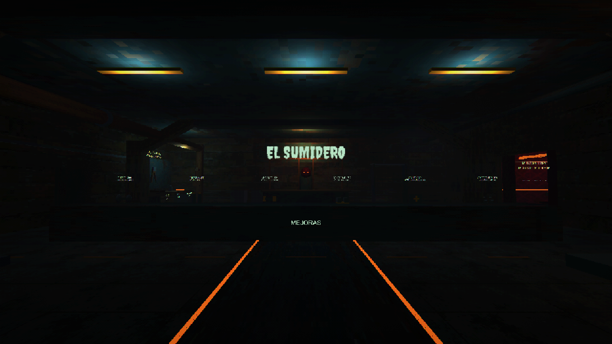
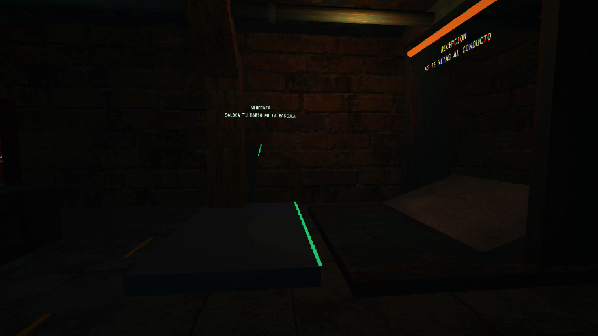
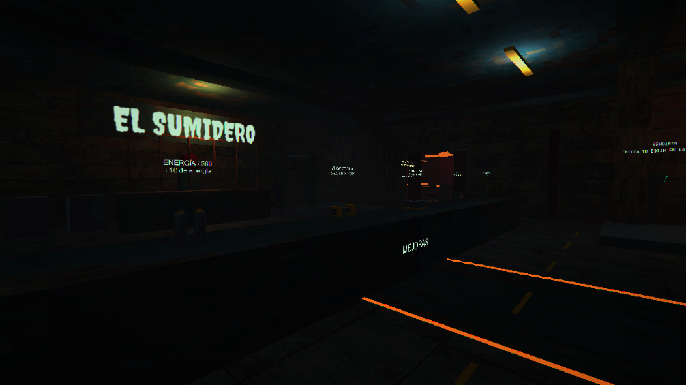
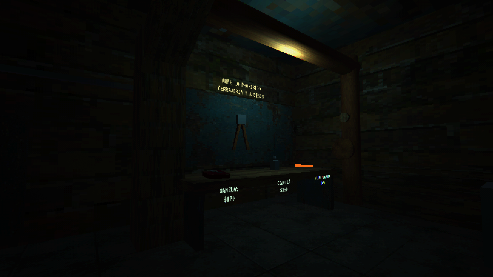
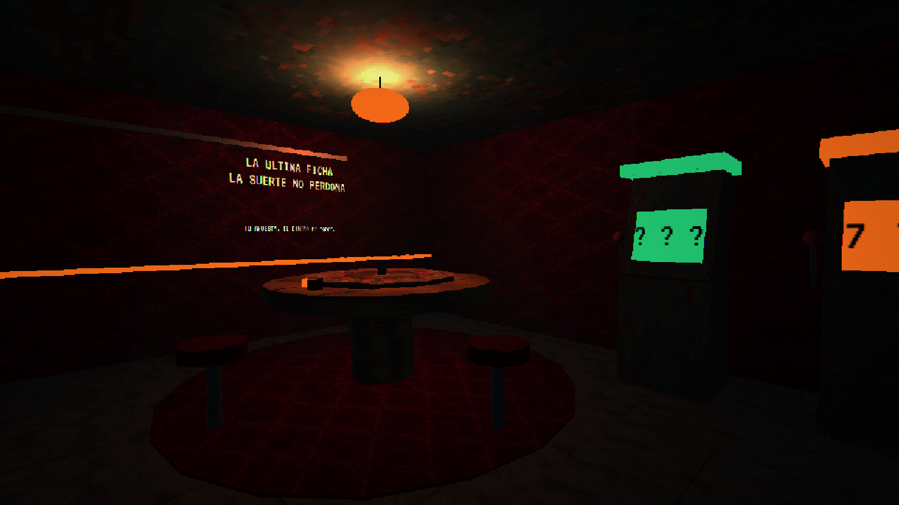
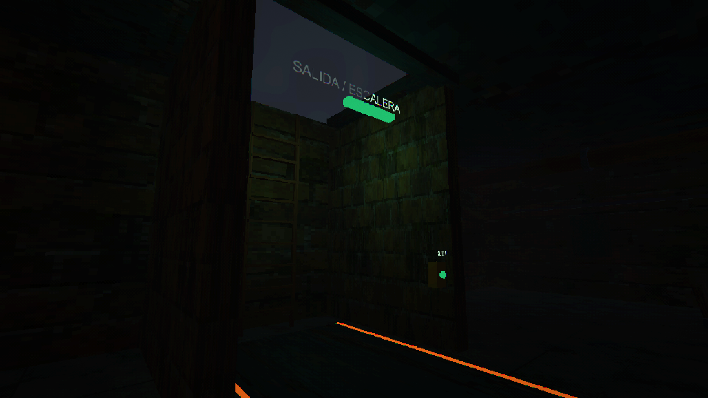
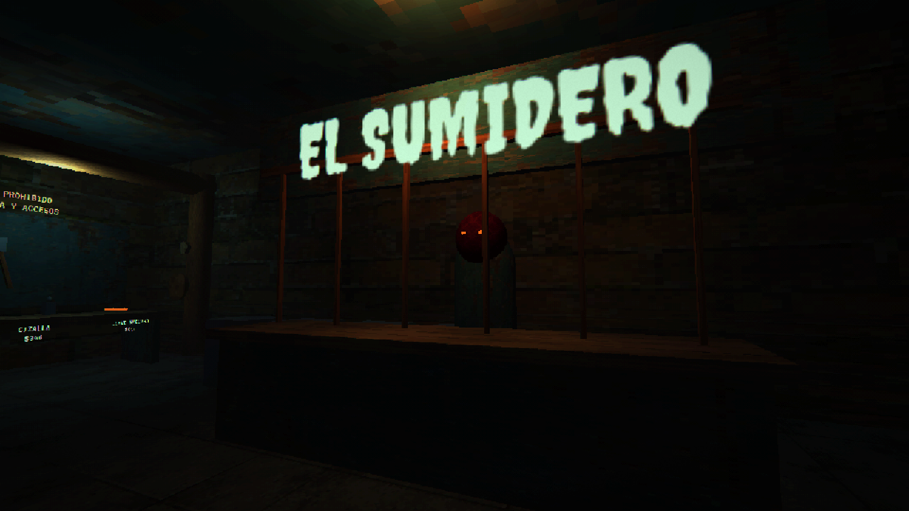

# El Sumidero — capturas de Unity

Escena real `remake_shop.unity`, 2026-10-12. Render URP con los materiales y estilo PSX del
proyecto; sin retoques. Son vistas del escenario modelado, no conceptos de ImageGen.
La [guía de edición y alcance](../SHOP.md) distingue escenario y mecánicas pendientes.

## Entrada y mostrador de mejoras

## Recepción de botín y vendimia

## Exhibidores de mejoras

## Cerrajería y herramientas de acceso

## Casino oculto — La Última Ficha

## Escalera y pulsador de subida

## Mostrador del comprador

